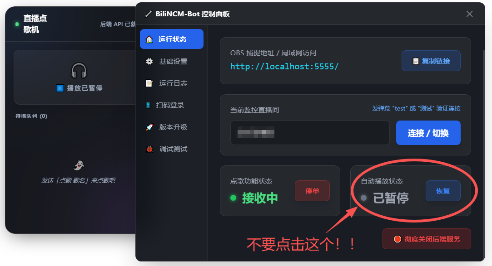
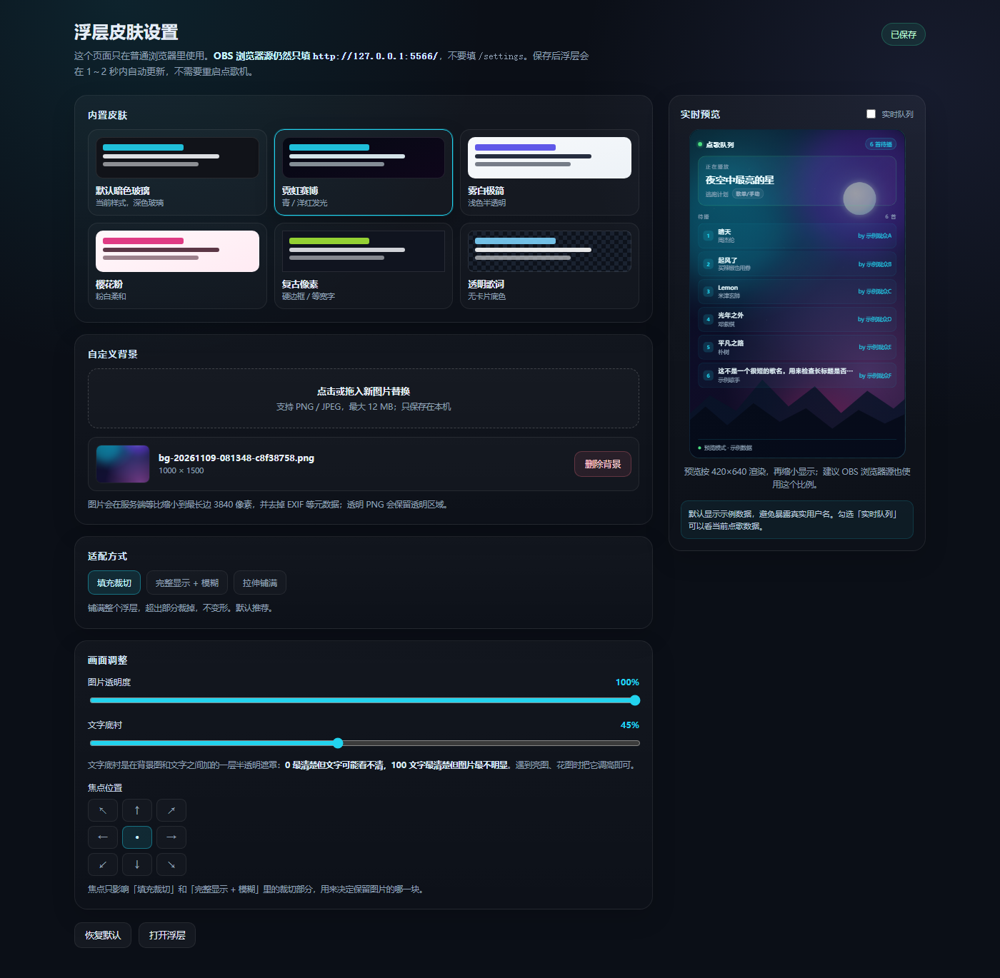
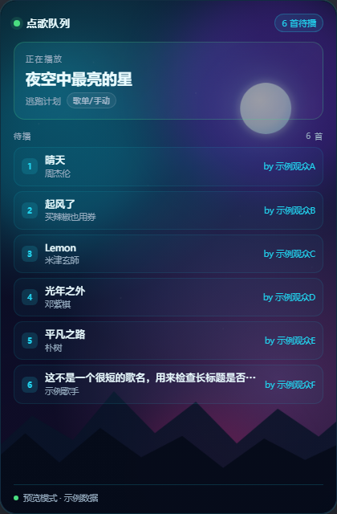

# BiliNCM_Companion

> 给 BiliNCM-Bot 加一层「不切歌」的点歌队列，外加一个 OBS 队列浮层。

> **唯一支持：网易云音乐 2.10.13。3.x 已确认不兼容；其他 2.x 版本未验证，不提供支持。**

`License: MIT` · `Platform: Windows 10/11 x64` · `PowerShell: 5.1` · `Bot: 1.0.1`

**先把两个地址分清：**

| 地址 | 是什么 | 怎么用 |
|---|---|---|
| `http://localhost:5555/` | 点歌机后台 / 控制面板 | 只用于扫码登录、填直播间房间号、查看连接状态；**不要**用它控制播放或队列 |
| `http://127.0.0.1:5566/` | OBS 队列浮层 | **OBS 浏览器源只能填这个地址** |
| `http://127.0.0.1:5566/settings` | 浮层皮肤 / 背景设置页 | 只在普通浏览器打开；**不要填进 OBS** |


---

## 这个项目解决什么问题

BiliNCM-Bot 原版自己管播放：点歌一进来就自动播，需要时会切歌。直播时这很要命——一首歌还没放完就被顶掉。

本项目的做法是：**把播放控制权交还给网易云自己的播放列表**，脚本只在旁边维护队列。

| 原版 | 本项目 |
|---|---|
| 自动播放、可能切歌 | 当前歌绝不打断，一首放完才轮下一首 |
| 插队 / 置顶改变顺序 | 只按先来后到排队（FIFO） |
| 同一首歌可能重复入队 | 自动合并，不会出现两个副本 |
| 队列看不见 | OBS 浮层实时显示当前歌 + 6 条待播 |
| — | 你在网易云里手动拖动，优先级最高 |

## 这个项目不是什么

- 不是 BiliNCM-Bot 的修改版 —— 原版 `BiliNCM-Bot.exe` 一个字节都没动
- 不包含网易云音乐客户端
- 不绕过任何平台限制，点歌权限仍由 bot 后台控制
- 不支持 macOS / Linux / 网易云网页版

---

## 一、下载

### 1.1 该下哪个文件

到本仓库的 [Releases](../../releases) 页面下载：

| 文件 | 大小 | 适合谁 |
|---|---|---|
| `BiliNCM_Companion-1.0.1-full.zip` | 约 75 MB | **第一次用的人**。官方 bot + 本项目全部脚本，解压即用 |
| `BiliNCM_Companion-1.0.1-scripts.zip` | 约 60 KB | 已经有官方 portable 包，只想补脚本 |
| `SHA256SUMS.txt` | 约 1 KB | 想校验下载完整性 |

**95% 的人只需要下第一个。**

### 1.2 解压

1. 完整解压到硬盘，例如 `D:\BiliNCM\`
2. 确认能看到 `启动点歌机.cmd` 和 `current\` 文件夹
3. 不要在压缩包里直接双击运行
4. 不要放在 `C:\Program Files`（权限问题）
5. 路径里避免 `!` `&` `%` 这类符号

### 1.3 校验（可选）

```powershell
Get-FileHash .\BiliNCM_Companion-1.0.1-full.zip -Algorithm SHA256
```

和 `SHA256SUMS.txt` 对比。

---

## 二、第一次使用

### 2.1 前置条件

| 项目 | 要求 |
|---|---|
| 系统 | Windows 10 1809 以上 / Windows 11，64 位 |
| PowerShell | 5.1（系统自带，不用装） |
| 网易云音乐 | PC 客户端，**已登录**，保持运行 |
| B 站账号 | 能进直播间、能开播 |
| OBS | 28 以上（只有用浮层才需要） |

不需要安装 .NET、Node.js、Python。

### 2.2 启动（第一次步骤多一点）

1. **先手动打开网易云音乐并登录**，让它保持运行
2. 双击 `启动点歌机.cmd`
3. 黑窗口依次执行：
   - 检查 B 站登录 → 没登录会弹二维码，用手机 B 站 App 扫码
   - 检查网易云是否带调试端口 → 没有就自动重启它（**会中断当前播放**）
   - 启动 companion、浮层服务、bot
   - 等点歌机后台的 5555 端口就绪、等 CDP 连上
4. 看到 `点歌机已启动，CDP 已就绪` 就成功了
5. 最后会问：

   ```
   是否彻底关闭点歌机? [Y=关闭 / N=保持运行并关闭此窗口]
   ```

   → **【推荐】如果想要保留cmd窗口，方便用完之后关闭点歌机：什么都不用输入，把cmd窗口最小化即可，使用完毕之后再输入 N**
   
   → 如果选 Y ：会把刚启动的东西全部关掉。
   
   → 如果选 N ：会把cmd窗口关掉，如果使用完毕后需要关闭点歌机，只能点击‘关闭点歌机.cmd’，否则点歌机会一直留在后台运行

### 2.3 填直播间房间号（5555 控制面板）

1. 浏览器打开 <http://localhost:5555/>。这是**点歌机后台 / 控制面板**，不是 OBS 浮层地址。
2. 进 bot 后台的「连接 / 设置」页。
3. 填你的**直播间房间号**，保存。
4. 页面显示已连接即可。

**‘5555控制面板’里只做这三件事：**

| 可以做 | 不要做 |
|---|---|
| 扫码登录 B 站 | 操作队列（置顶、删除、清空等） |
| 填直播间房间号 | 播放 / 暂停 / 切歌 |
| 查看连接状态 | 点「恢复自动播放」 |
|  | 点「彻底关闭后端服务」 |
|  | 改房间号以外的设置 |

#### ⚠️ <ins>尤其不要点「恢复自动播放」</ins>

**<ins>填完房间号、确认连接正常后，可以回来看连接状态，但不要点 5555 里的任何操作按钮。尤其是「运行状态」页右下角「自动播放状态」旁边的「恢复」按钮——点它会让 bot 重新抢走播放权，Companion 的队列控制会失效。</ins>**



**图中红圈标出的「恢复」按钮就是「恢复自动播放」，不要点。**

:tired_face: 如果需要看真实播放状态，请打开 5566 浮层或网易云右侧「播放列表」，不要回 5555 点按钮。

### 2.4 添加 OBS 浮层

> **⚠️ 这一节只填 5566。5555 是后台，不能填进 OBS。**

1. OBS → 来源 → `+` → **浏览器**
2. 名称随意，比如 `点歌队列`
3. **<ins>:tired_face: URL 只填 http://127.0.0.1:5566/</ins>**

   **<ins>:tired_face: 不要填 2.3 里的 http://localhost:5555/</ins>**
4. 宽度 `420`，高度 `640`（按画面比例自己缩放）
5. 其他保持默认，**不要**加自定义 CSS —— 页面背景本来就是透明的
6. 确定后应看到深色卡片和「暂无待播点歌」

#### 可选：换皮肤 / 自定义背景

浏览器打开 <http://127.0.0.1:5566/settings>。这个页面同样只给普通浏览器用，**不要填进 OBS**。

- 6 套皮肤：默认暗色玻璃、霓虹赛博、雾白极简、樱花粉、复古像素、透明歌词
- 可上传 PNG / JPEG 背景图（最大 12 MB），调整图片透明度、文字底衬和焦点位置
- 右侧实时预览默认用示例数据；所有设置自动保存，1～2 秒后 OBS 浮层自动更新，不需要重启点歌机
- 背景图只保存在本机 `overlay-assets\`，不会上传到网络





### 2.5 验收清单

- [ ] 启动窗口最后显示 `点歌机已启动，CDP 已就绪`
- [ ] `http://localhost:5555/` 能打开点歌机后台 / 控制面板
- [ ] OBS 浮层底部是**绿点**，文字「已连接」
- [ ] 用自己号发一条 `点歌 晴天`，这首歌会插在当前歌后面 / 最后一个待播之后（不一定是列表末尾）
- [ ] 当前歌继续正常播放，没有被切掉

五条全过 = 装好了。

---

## 三、日常使用

### 3.1 开播前（30 秒）

1. 确认网易云已登录、正在放歌
2. 双击 `启动点歌机.cmd`，等到 `CDP 已就绪`，输入 `N`
3. 看 OBS 浮层是不是绿点

点歌机已经在跑时，再次双击只会补启动缺失的组件，不会重复开。

### 3.2 观众怎么点歌

在直播间发弹幕：

| 指令 | 作用 | 默认权限 |
|---|---|---|
| `点歌 歌名` | 加到待播队列末尾 | 粉丝牌等级 |
| `点歌 歌名 歌手` | 同上，推荐带歌手，避免点到翻唱 | 粉丝牌等级 |
| `撤回` / `取消` | 撤回自己最近点的一首 | 粉丝牌等级 |
| `移除 歌名` | 从队列删掉指定歌 | 房管 / 超管 |
| `开启点歌` / `关闭点歌` | 暂停或恢复接收点歌 | 房管 / 超管 |
| `test` / `测试` | 测试弹幕连接 | 无限制 |

权限在 bot 后台「权限设置」里调。

**本方案下行为有变化的指令：**

| 指令 | 变化 |
|---|---|
| `置顶(点歌) 歌名` | **不再生效**。队列只认到达顺序，置顶不会让歌提前（设计取舍，不是 bug，见第四节） |
| `插队(点歌) 歌名` | 属于强制播放指令，**会打断当前歌**。建议关掉这条权限 |
| `立即播放 歌名` | 同上，会打断当前歌 |
| `切歌` / `跳过` | bot 直接跳过当前歌 → 会打断。建议只留给超管 |

**一句话：想让某首歌提前，去网易云里手动拖，不要用弹幕指令。**

### 3.3 主播管队列（最高权限在网易云）

打开网易云右侧「播放列表」，那就是真实队列：

| 你想做的事 | 怎么做 | 生效时间 |
|---|---|---|
| 让某首歌下一首放 | 拖到当前歌下面 | 立刻，脚本不会改回去 |
| 删掉某首点歌 | 在列表里删掉 | 下一次轮询同步到浮层 |
| 自己插一首歌 | 右键「下一首播放」 | 立刻 |
| 换当前歌 | 双击列表里的歌 | 立刻 |
| 暂停接单 | 发 `关闭点歌` 或后台关 | 立刻，浮层显示暂停 |

**脚本永远不会覆盖你在网易云里的手动操作。**

### 3.4 浮层怎么看

- 上方大卡片：当前歌 + 谁点的（`d` 标签 = 点歌来的，`manual` = 你手动放的）
- 中间列表：接下来要放的点歌，最多 6 条，第 7 条起显示「还有 N 首」
- 底部：🟢 正常 · 🟡 暂停接单 · 🔴 数据断开
- 想换皮肤或加背景图：打开 <http://127.0.0.1:5566/settings>（只给普通浏览器用，不要填进 OBS）

### 3.5 下播

双击 `关闭点歌机.cmd`，确认。它只关 bot / companion / 浮层，**不会关网易云**。

### 3.6 更新

1. 下播后双击 `关闭点歌机.cmd`
2. 下载新版 `scripts.zip`，把里面的 `.ps1` / `.html` / `.cmd` / `qrcode.js` 覆盖到原目录（新版设置页 `BiliNCM-Overlay-Settings.html` 也在里面）
3. **不要覆盖 `current\` 文件夹和 `config.json`**，否则要重新扫码登录、重新填房间号；想保留皮肤和背景，也不要删 `overlay-config.json` 和 `overlay-assets\`
4. 重新启动

### 3.7 常见操作速查

| 场景 | 做法 |
|---|---|
| 临时不接点歌 | 弹幕发 `关闭点歌`，或后台关 |
| 当前歌不想听 | 在网易云里点下一首（别用弹幕切歌） |
| 队列乱了 | 在网易云里手动拖，脚本跟着你的顺序走 |
| 浮层卡住 | 看 `overlay.log`，或重启点歌机 |
| 换电脑 | 整个文件夹拷过去，重新扫码登录 |

---

## 四、运作逻辑（不关心底层可以跳过）

### 4.1 三个端口，各管什么

| 组件 | 端口 | 职责 |
|---|---|---|
| BiliNCM-Bot | 5555 | 点歌机后台 / 控制面板：接弹幕、维护队列、提供 `/data`；只用于扫码登录、填房间号、看连接状态 |
| Companion | — | 每秒读 bot 队列，把新点歌写进网易云；生成浮层状态文件 |
| Overlay | 5566 | OBS 浮层页面 + `/settings` 皮肤 / 背景设置页：把状态文件渲染成网页；**唯一能填进 OBS 的地址** |
| 网易云 CDP | 9222 | Companion 通过它操作播放列表；不需要你手动打开 |

你只需要记住 5555 和 5566；9222 是 Companion 自己用的，不要填进 OBS。

```
B站弹幕 ─► BiliNCM-Bot :5555 ──/data──► Companion
                  │                        │
                  └── CDP :9222 ───────────┤
                                           ▼
                                  网易云播放列表（真实队列）
                                           │
                                    overlay-state.json
                                           ▼
                        Overlay :5566 ──► OBS 浏览器源
```

### 4.2 为什么先暂停 bot 的自动播放

bot 原版逻辑是「有歌就播」，它会自己抢播放权。Companion 启动后调用 `/api/state/toggle_play` 把它的自动播放暂停，让**网易云播放列表成为唯一真相**。

如果 bot 的自动播放被人为恢复，Companion 不会强行再暂停（避免两边死循环），而是在浮层弹黄色警告。这时别点暂停，等当前歌自然放完再处理。

所以 Companion 模式下，5555 的「正在播放」为空是正常的；真实状态看 5566 或网易云右侧「播放列表」。

### 4.3 队列的三条规则

队列不是从第 0 项开始算的——它包含历史、当前歌、待播。所有判断都相对**当前播放位置**：

1. **当前歌不动**：不切、不移、不强制播放
2. **新点歌插在「最后一个待播 d」之后**
3. **没有待播 d 时，插在当前歌之后**

**一句话：新歌插在当前歌后面 / 最后一个待播之后（不一定是列表末尾）。**

内部把每条点歌请求记作 `d`（demand），带一个递增的 `Seq`，按 `Seq` 排序 —— 这就是 FIFO 的实现方式。

### 4.4 去重与升级

| 情况 | 行为 |
|---|---|
| 歌正在播 / 已在待播区 | 合并，不重复加 |
| 歌已经播过，又被点 | **不新增副本**，把原来那条挪到待播队尾（升级） |
| 点歌人在 bot 里撤回 | Companion 同步取消，不会加进去 |
| 你在网易云里手动删掉 | 标记为已结束，**不会再加回来** |

### 4.5 为什么「置顶」不生效

Companion 只关心「哪些 id 是新的、哪些还没播」，**完全不读 bot 的内部排序**。bot 的置顶只是改它自己的数组顺序，Companion 看不到也不关心。

这是刻意的：如果 Companion 也维护一份顺序，你手动拖网易云就会被它改回去，两边永远打架。所以设计上只允许一个权威——网易云。

### 4.6 8 秒判定

- Companion 每 1 秒轮询一次
- 浮层拿到的状态超过 **8 秒**没更新 → 判定「数据断开」，整张卡片变暗、底部变红
- 不要把这个阈值调大：它就是为了让你在开播前一眼看出 companion 挂了

### 4.7 边界情况

| 情况 | 处理 |
|---|---|
| bot 重启 | 重建基线，已存在的队列当成历史，不重复加 |
| 网易云重启 | 等 CDP 恢复后继续，期间不做队列操作 |
| 同时启动两次 | 互斥锁，第二个实例直接退出 |
| 点歌在入队前被撤回 | 检测到 bot 队列消失，取消入队 |

---

## 五、版本兼容性

### 5.1 测试基线

| 组件 | 版本 |
|---|---|
| BiliNCM-Bot | 1.0.1（commit `aedadd6`） |
| 网易云音乐 | 2.10.13.202675 |
| Windows | 10 22H2 / 11 |
| PowerShell | 5.1 |
| OBS | 30.x |

唯一支持：网易云音乐 2.10.13。3.x 已确认不兼容；其他 2.x 版本未验证，不提供支持。

### 5.2 已知风险

| 风险 | 影响 | 建议 |
|---|---|---|
| 网易云自动更新 | CDP 目标页、内部 store 结构可能变，队列操作失效 | 建议关闭自动更新（3.x 不兼容）；更新后先跑一次验收清单 |
| bot 更新 | `/data` 字段可能变 | 升级前看 Release 说明，别第一时间上 |
| bot 启动时重启网易云 | 当前播放会中断 | bot 自身行为，包装器无法阻止 |
| 网易云未登录 | 点歌加不进队列 | 每次开播前确认登录态 |
| 杀软拦截 PowerShell | 启动一闪而过 | 把整个目录加白名单 |
| 端口 5555/5566 被占 | 启动失败 | 关掉残留进程再试 |

### 5.3 不支持

- 网易云音乐 3.x（已确认不兼容）
- 其他未验证的 2.x 版本（不提供支持）
- macOS / Linux
- 网易云网页版、极简版、手机版
- 多开（一个房间一个实例）

---

## 六、故障排查

| 现象 | 可能原因 | 处理 |
|---|---|---|
| 5555 里「当前歌 / 正在播放」为空，待播列表只增不减 | Companion 模式下 5555 不反映真实播放状态，且 bot 自动播放已被暂停 | 看 5566 浮层或网易云右侧「播放列表」；不要点 5555 的「恢复自动播放」 |
| 点歌只排队，不自动播放 | Companion 只负责把歌插进网易云队列，不会主动起播；要等当前歌自然放完 | 保持网易云正在播放；不要用 5555 的播放 / 暂停按钮 |
| 播完一首就停，列表循环没用 | 网易云播放模式被改成单曲播放，或队列里没有下一首 | 把网易云播放模式改为列表循环；确认待播队列不为空 |
| OBS 里显示的是点歌机后台，不是浮层 | 浏览器源填了 5555 | 把浏览器源改成 `http://127.0.0.1:5566/` |
| 双击后窗口一闪而过 | 杀软拦截 / 脚本缺失 | 加白名单；看 `launcher.log` |
| 提示找不到 `BiliNCM-Bot.exe` | 解压不完整 / 被杀软删了 | 重新解压，检查 `current\` |
| 卡在「CDP 端口未就绪」 | 网易云没用调试端口启动 | 按提示重启；或手动带 `--remote-debugging-port=9222` 启动 |
| 浮层显示「数据断开」 | Companion 没跑 / 已退出 | 看 `companion.log`，重启点歌机 |
| 点歌没进网易云 | 网易云未登录 / CDP 断了 / 搜不到歌 | 先手动搜一次确认歌存在 |
| 二维码不显示 | 网络 / B 站接口变动 | 双击 `调试登录.cmd`，看 `login-debug.log` |
| 设置页打不开 | 浮层服务没启动 / 端口被占 | 先打开 `http://127.0.0.1:5566/health` 确认正常，再看 `overlay.log`；刷新页面 |
| 换了皮肤 / 背景但 OBS 没变 | 设置没保存 / OBS 浏览器源缓存 | 确认设置页右上角显示「已保存」，等 1～2 秒；在 OBS 里刷新浏览器源 |
| 自定义背景不显示 | 图片文件被删 / 手动改了文件名 | 回设置页重新上传；不要改 `overlay-assets\` 里的文件名；刷新浏览器源 |
| 浮层白底 | 页面没加载成功 | 浏览器直接开 `http://127.0.0.1:5566/` 测试 |
| 透明歌词皮肤在 OBS 里不透明 | 浏览器源加了自定义 CSS / 黑色背景 | 清空浏览器源的自定义 CSS；页面背景本身是透明的 |
| 置顶没反应 | **预期行为** | 去网易云里手动拖 |
| 当前歌被切了 | 有人发了 `插队` / `切歌` | 关掉这两条指令的权限 |

日志都在程序根目录：`launcher.log`、`companion.log`、`overlay.log`、`bot-runtime.log`。

---

## 七、文件说明

| 文件 | 作用 | 能删吗 |
|---|---|---|
| `启动点歌机.cmd` | 一键启动 | 否 |
| `关闭点歌机.cmd` | 彻底关闭 | 否 |
| `调试登录.cmd` | 登录诊断 | 否 |
| `BiliNCM-Launcher.ps1` | 启动编排、CDP 检查 | 否 |
| `BiliNCM-Companion.ps1` | 队列同步核心 | 否 |
| `BiliNCM-Overlay.ps1` / `.html` | 浮层服务与页面 | 不用浮层可删 |
| `BiliNCM-Overlay-Settings.html` | 皮肤 / 背景设置页（`5566/settings`） | 不用设置页可删；删后浮层仍正常 |
| `overlay-config.json` | 皮肤 / 背景配置（自动生成） | 删掉即恢复默认；会丢失当前皮肤和背景设置 |
| `overlay-assets\` | 上传的背景图（自动生成） | 删掉即删除背景；不要手动改文件名 |
| `BiliLoginFix.ps1` | B 站扫码登录 | 否 |
| `Capture-BotLogs.ps1` | 抓 bot 运行日志 | 可删（不影响功能） |
| `Test-NcmCdp.ps1` | CDP 连通性诊断 | 可删 |
| `qrcode.js` | 二维码渲染（MIT） | 否 |
| `*.log` | 运行日志 | 随时可删 |

### 常用参数

```powershell
# 只检查环境，不启动
.\启动点歌机.cmd -CheckOnly

# 网易云装在非标准路径
.\启动点歌机.cmd -NcmExe "D:\CloudMusic\cloudmusic.exe"

# 跳过 B 站登录检查（调试用）
.\启动点歌机.cmd -SkipLoginCheck

# 换 CDP 端口
.\启动点歌机.cmd -CdpPort 9223
```

---

## 八、安全与隐私

- 所有服务只监听 `127.0.0.1`，**不要**把 5555 / 5566 映射到公网
- `current\config.json` 保存着你的 B 站 Cookie 和登录凭证：**不要截图、不要上传、不要发给别人**
- 自定义背景图只保存在本机 `overlay-assets\`，不会上传到网络；`overlay-config.json` 只记录皮肤和图片参数，不包含 Cookie / 房间号
- 本仓库和 Release 包里**不包含任何 Cookie、日志、房间号**
- 日志里的 `SESSDATA` 已自动脱敏
- 本项目不收集任何数据，不联网上报

---

## 九、许可与致谢

- **BiliNCM-Bot**：作者 [Enkianssus](https://github.com/Enkianssus/BiliNCM-Bot)，上游 README 声明 MIT License
- **BiliNCM_Companion 脚本**：本项目作者，MIT
- **qrcode.js**：davidshimjs，MIT

完整条款见 [LICENSE](LICENSE)，第三方声明见 [NOTICE](NOTICE)。

本项目与哔哩哔哩、网易云音乐无隶属关系，不包含网易云音乐客户端。
如权利人认为本项目的分发方式不妥，请提 Issue，会立即移除相关内容。
